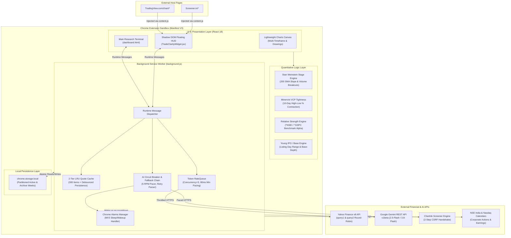
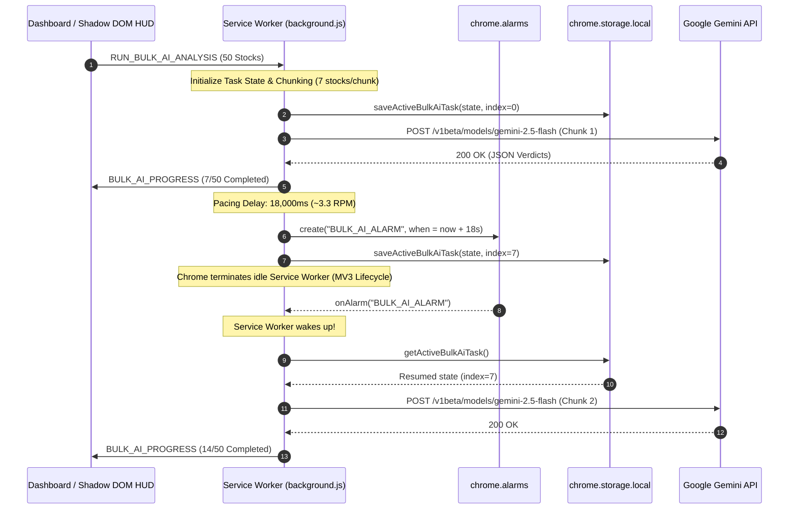
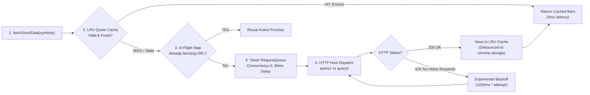
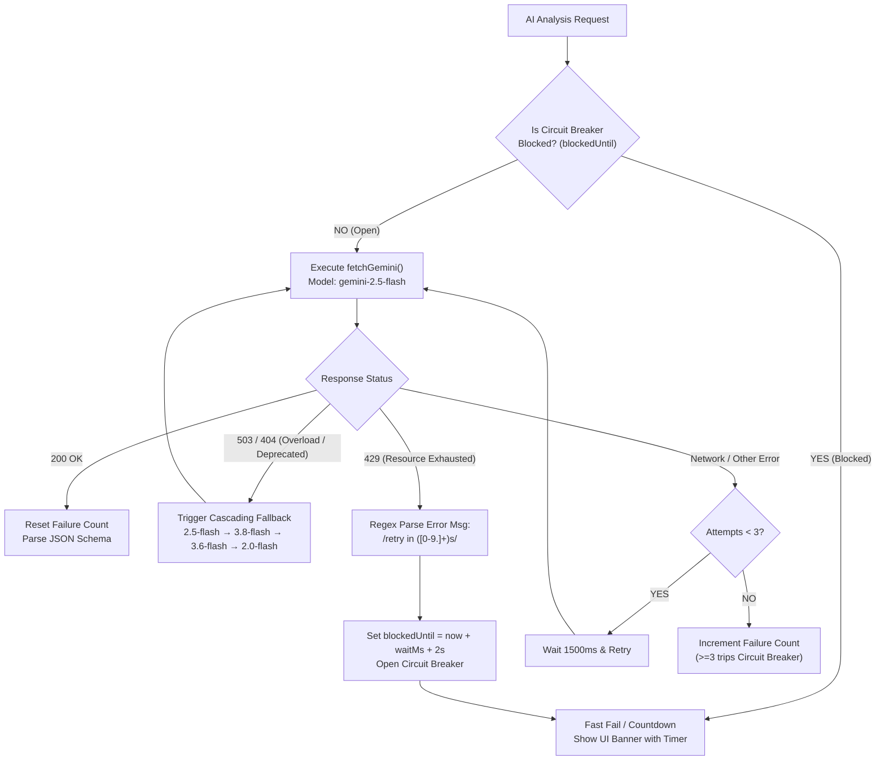
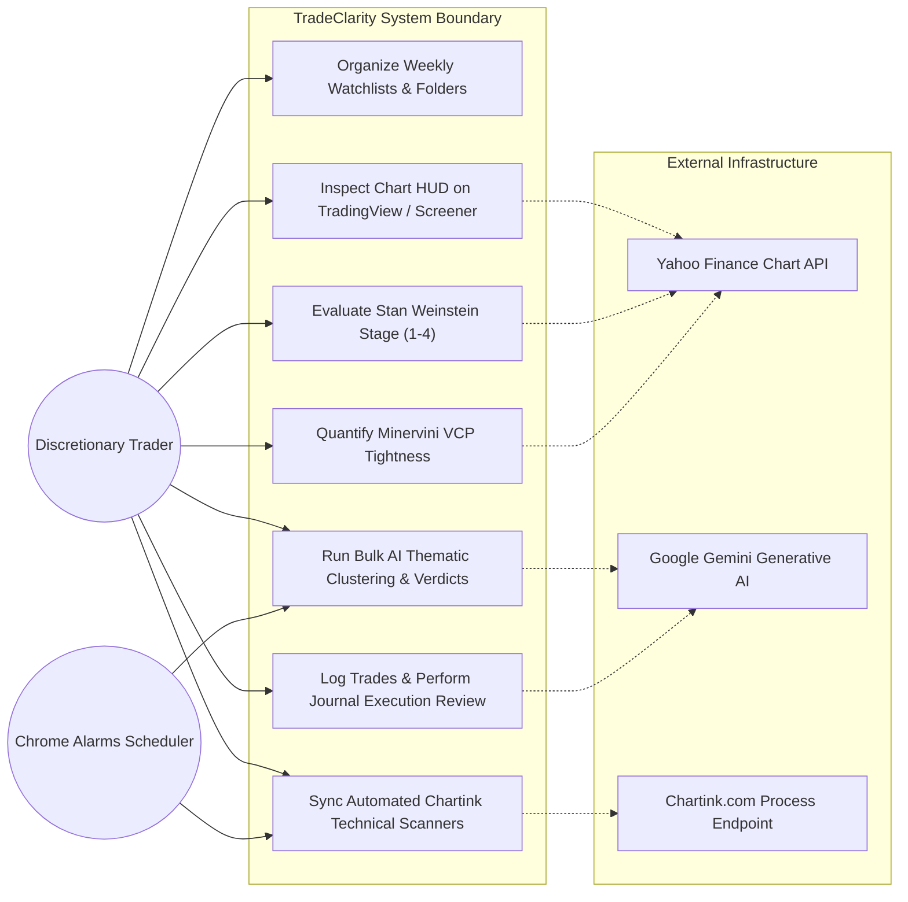
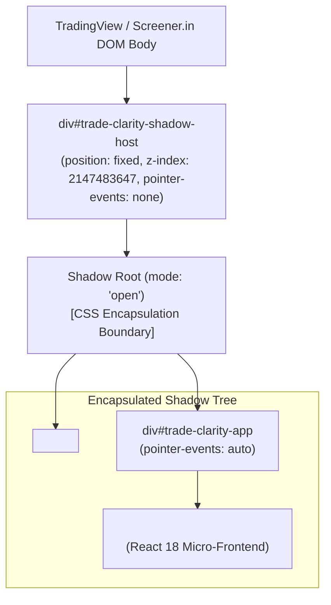

# TradeClarity.market — Architecture, Technical Internals & Interview Master Guide

> **System Overview:** An institutional-grade swing trading quantitative terminal and browser HUD built as a **Chrome Extension (Manifest V3)** using **React 18**, **Tailwind CSS**, and **Lightweight Charts**. It features real-time financial market analytics (NSE & US), multi-layer rate-limited data pipelines, automated quantitative stage algorithms (Weinstein & Minervini), and resilient **Google Gemini AI** integrations with circuit breakers and cascading model failover.

---

## Table of Contents
1. [High-Level Architecture Diagram](#1-high-level-architecture-diagram)
2. [Component Architecture & Manifest V3 Event Model](#2-component-architecture--manifest-v3-event-model)
3. [Yahoo Finance Data Fetching & Rate-Limit Avoidance](#3-yahoo-finance-data-fetching--rate-limit-avoidance)
4. [Google Gemini AI Integration & Zero-Failure Resilience](#4-google-gemini-ai-integration--zero-failure-resilience)
5. [System Use Case Diagram](#5-system-use-case-diagram)
6. [Quantitative Logic & Algorithmic Engines](#6-quantitative-logic--algorithmic-engines)
7. [Shadow DOM HUD Injection Architecture](#7-shadow-dom-hud-injection-architecture)
8. [Storage Partitioning & Performance Optimization](#8-storage-partitioning--performance-optimization)
9. [Senior Interview Preparation: Key Concepts & Star Answers](#9-senior-interview-preparation-key-concepts--star-answers)

---

## 1. High-Level Architecture Diagram



---

## 2. Component Architecture & Manifest V3 Event Model

Under Chrome Manifest V3, extensions no longer have persistent background pages. Instead, background logic runs in an **ephemeral Service Worker** that Chrome terminates after ~30 seconds of inactivity.



---

## 3. Yahoo Finance Data Fetching & Rate-Limit Avoidance

To pull daily and intraday candlestick data across large watchlists without getting blocked by Yahoo Finance, TradeClarity uses a **5-layer defensive pipeline**:



### Detailed Internals:
1. **LRU In-Memory & Persistent Cache (`LRUQuoteCache`):**
   - Stores up to 300 stocks in memory.
   - **Market-Aware Dynamic TTL:**
     - Market Closed (Weekends / After-hours): **8 Hours** TTL.
     - Market Open (Regular trading hours): **3 Minutes** for active quotes, **15 Minutes** for historical quotes.
   - **Strict Calendar Boundary Validation:** Any data fetched on a previous calendar day is immediately declared stale.
   - **Market Transition Invalidation:** If data was fetched when market was closed, but market has now opened, the cache entry is invalidated immediately to force live quote fetching.
   - **Debounced Storage Persistence:** Synchronizes dirty cache entries to `chrome.storage.local` with a 500ms debounce timer to minimize flash writes.
2. **In-Flight Request Deduplication (`inFlightStockRequests`):**
   - Prevents duplicate requests when multiple UI components (e.g. Dashboard Table + Lightweight Chart + HUD) request the same ticker concurrently.
   - Reuses a single shared Promise for identical URLs.
3. **Token Queue with Priority Scheduling (`RequestQueue`):**
   - Global concurrency limit: **3 requests maximum**.
   - Minimum delay between outbound network calls: **80ms**.
   - **VIP Jump-the-Queue:** Interactive single-stock lookups use `isHighPriority = true`, calling `queue.unshift()` to execute ahead of background watchlist refreshes.
4. **Batch Partitioning:**
   - Watchlists are chunked into batches of 5 (`BATCH_SIZE = 5`).
   - If network calls were made in a batch, the engine introduces an enforced 250ms inter-batch sleep to prevent TCP connection saturation.
5. **Round-Robin DNS & Exponential Backoff:**
   - Rotates between `query1.finance.yahoo.com` and `query2.finance.yahoo.com`.
   - On HTTP 429, attempts automatic backoff: `delay = 1200ms * attemptNumber` (up to 3 retries).

---

## 4. Google Gemini AI Integration & Zero-Failure Resilience

TradeClarity connects to Google Gemini via direct REST calls to `https://generativelanguage.googleapis.com/v1beta/models/${model}:generateContent`.



### Key AI Architecture Capabilities:
1. **Cascading Model Fallback:**
   - Prevents hard outages when Google models undergo maintenance or deprecation.
   - Default sequence: `gemini-2.5-flash` $\rightarrow$ `gemini-3.8-flash` $\rightarrow$ `gemini-3.6-flash` $\rightarrow$ `gemini-3.5-flash` $\rightarrow$ `gemini-2.0-flash`.
2. **Regex Rate-Limit Delay Extraction:**
   - Rather than guessing wait times, TradeClarity extracts exact quota reset intervals from Google Gemini's error body:
     ```javascript
     const match = errorMessage.match(/retry in ([\d.]+)s/i);
     const waitMs = match ? Math.ceil(parseFloat(match[1]) * 1000) + 2000 : 65000;
     ```
3. **Circuit Breaker Pattern:**
   - Avoids sending wasted HTTP requests when quota is exhausted.
   - Tripped on HTTP 429 or 3 consecutive network failures.
   - Pushes `AI_LIMIT_REACHED` event across extension runtime to render an interactive countdown capsule in the UI.
4. **VIP Lane for Discretionary Traders:**
   - Single-stock Deep Views pass `skipCircuitBreaker: true`, bypassing background queue waits for immediate single-stock verdicts.
5. **Structured Schema Output:**
   - Uses Gemini's `responseMimeType: "application/json"`.
   - Forces the model to return strict JSON arrays matching quantitative schemas (e.g. `macroTheme`, `thematicVectors`, `stage`, `verdict`, `entryPivot`, `stopLoss`).

---

## 5. System Use Case Diagram



---

## 6. Quantitative Logic & Algorithmic Engines

All technical indicators in TradeClarity are calculated client-side in pure TypeScript/JavaScript using mathematical models:

### 1. Stan Weinstein Stage Analysis (`calculateStageMetric.ts`)
Evaluates 200 daily OHLCV candles to determine market cycle stages:
- **SMA Calculation:** Computes 200-day Simple Moving Average (SMA200).
- **Slope Detection:** Calculates the 20-day percentage slope of the 200 SMA:
  $$\text{Slope}_{\text{SMA200}} = \left(\frac{\text{SMA}_{200}(t) - \text{SMA}_{200}(t-20)}{\text{SMA}_{200}(t-20)}\right) \times 100$$
- **Stage Classification:**
  - **Stage 2 (Advancing):** Price > SMA200 AND $\text{Slope}_{\text{SMA200}} > +0.25\%$. If latest volume > 1.5x 50-day average volume, tagged as **Volume Breakout**.
  - **Stage 4 (Declining):** Price < SMA200 AND $\text{Slope}_{\text{SMA200}} < -0.25\%$.
  - **Stage 1 (Accumulation) / Stage 3 (Distribution):** $|\text{Slope}_{\text{SMA200}}| \le 0.25\%$ with price consolidating around the baseline.

### 2. Minervini Volatility Contraction Pattern (VCP) Tightness (`calculateVcpTightness.ts`)
Measures institutional price contraction across the last 10 trading sessions:
$$\text{Tightness \%} = \left(\frac{\max(\text{High}_{10}) - \min(\text{Low}_{10})}{\min(\text{Low}_{10})}\right) \times 100$$
- **Tight ($< 4.0\%$):** Institutional absorption / coil. Ready for pivot breakout.
- **Moderate ($4.0\% - 7.0\%$):** Orderly consolidation.
- **Wide ($> 7.0\%$):** High volatility / loose action; not ready for low-risk entry.

### 3. Young IPO Protection Engine (`detectYoungIPO.ts` & `detectIPOBase.ts`)
- Prevents premature Stage 4 misclassification for newly listed stocks lacking 200 trading days.
- Exempts stocks from 200 SMA rules if total candles $< 250$.
- Evaluates first-day high/low boundaries, base depth, and 10/20 EMA support.

---

## 7. Shadow DOM HUD Injection Architecture



### Why Shadow DOM?
- **Zero Style Leakage:** TradingView's complex CSS resets cannot override TradeClarity's typography or Tailwind utilities.
- **Zero Host Breakage:** TradeClarity styles cannot alter host webpage elements.
- **Pointer Event Passthrough:** The host container has `pointer-events: none`, allowing mouse clicks to pass through to underlying TradingView chart tools. Only interactive buttons on the TradeClarity HUD re-enable `pointer-events: auto`.

---

## 8. Storage Partitioning & Performance Optimization

To prevent Chrome local storage performance degradation from multi-megabyte JSON operations, TradeClarity partitions data into modular keys:

| Storage Key | Content | Refresh / Access Pattern |
|---|---|---|
| `tc_weeks_active_IN` | Current & upcoming week watchlists for NSE | High frequency (read/write on every edit) |
| `tc_weeks_active_US` | Current & upcoming week watchlists for US | High frequency |
| `tc_weeks_archive_IN` | Historical past weeks for NSE | Lazy loaded on demand when scrolling history |
| `tc_weeks_archive_US` | Historical past weeks for US | Lazy loaded on demand |
| `tc_config` | User preferences, custom prompts, UI layout | Loaded once at startup |
| `tc_caches` | Sector mapping & multi-thematic cache | Incremental sync |
| `quoteCache` | Serialized LRU candlestick quote cache | Debounced (500ms) sync |
| `active_bulk_ai_task` | In-flight MV3 background AI queue state | Written per-chunk for lifecycle restoration |

---

## 9. Senior Interview Preparation: Key Concepts & Star Answers

### Elevator Pitch (60 Seconds)
> *"TradeClarity is an institutional-grade market research terminal and browser HUD built as a Chrome Extension (Manifest V3) using React 18, Tailwind, and Lightweight Charts. It provides quantitative swing trading intelligence for Indian (NSE) and US equities. 
> 
> What makes it technically compelling is its zero-backend, resilient client-side architecture: it streams market data directly from Yahoo Finance and corporate filings through a 5-layer rate-limiting pipeline (featuring LRU caching, market-aware TTLs, and token queues), evaluates quantitative models like Stan Weinstein Stage Analysis and Minervini VCP tightness in client-side TypeScript, and embeds an AI copilot powered by Google Gemini. 
> 
> To survive Chrome MV3's aggressive service worker terminations during multi-minute AI analysis batches, I designed an alarm-driven state hydration engine that persists queue snapshots to storage and resumes execution across browser lifecycles without data loss."*

### Key Technical Questions & STAR Responses

#### Q1: "How do you avoid Yahoo Finance rate limits and IP blocking without a proxy server?"
- **Situation:** Users scan watchlists containing 50-100 stocks. Firing 100 simultaneous HTTP GET requests to Yahoo Finance triggers HTTP 429 errors and temporary IP bans.
- **Task:** Build a high-throughput, client-side data engine that reliably fetches candlestick data without exceeding Yahoo's unauthenticated thresholds.
- **Action:**
  1. Built an in-memory `LRUQuoteCache` (300 items) with **Market-Aware TTLs** (8 hours when closed; 3 minutes when open) and strict calendar-day boundaries.
  2. Implemented an **In-Flight Request Deduplication Map** so concurrent UI components share a single active fetch Promise.
  3. Created a token bucket `RequestQueue` capping concurrency at 3 simultaneous requests with an enforced 80ms delay, giving user clicks top priority via `queue.unshift()`.
  4. Added round-robin failover between `query1.finance.yahoo.com` and `query2.finance.yahoo.com` with exponential backoff on HTTP 429.
- **Result:** Decreased outbound network calls by >70% across user sessions, virtually eliminating HTTP 429 rate limit exceptions.

#### Q2: "How did you overcome Chrome Manifest V3's ephemeral Service Worker limitations during bulk AI processing?"
- **Situation:** Under MV3, background service workers terminate after ~30 seconds of inactivity. Pacing Gemini API calls at 3.3 RPM (to stay within free-tier 5 RPM quotas) requires ~18 seconds between chunks, meaning a 50-stock watchlist takes 10+ minutes. An in-memory queue would be wiped when Chrome kills the worker.
- **Task:** Ensure bulk AI processing survives service worker termination, sleep cycles, and browser tab closing.
- **Action:**
  1. Built an asynchronous task persistence engine: after processing each chunk of 7 stocks, the service worker saves the active task state, completed results, and current index to `chrome.storage.local` (`active_bulk_ai_task`).
  2. Scheduled a `chrome.alarms` countdown timer for the next execution interval.
  3. Registered top-level event listeners for `chrome.alarms.onAlarm` and worker startup (`chrome.runtime.onStartup`) that re-hydrate the queue state from storage and seamlessly resume chunk processing.
- **Result:** 100% completion rate for background AI batch tasks across arbitrary queue lengths, fully immune to MV3 worker terminations.

#### Q3: "How do you prevent hallucinations and ensure high-conviction AI responses from Gemini?"
- **Situation:** Raw LLMs often output conversational filler, hallucinate non-existent technical patterns, or fail to adhere to disciplined risk-management frameworks.
- **Task:** Direct the LLM to output precise, institutional-grade quantitative verdicts adhering strictly to Mark Minervini's SEPA and William O'Neil's CANSLIM methodologies.
- **Action:**
  1. Enforced structured JSON output schemas via `generationConfig: { responseMimeType: "application/json" }`.
  2. Fed pre-calculated quantitative parameters (Weinstein stage, VCP contraction %, ADR, liquidity, moving average alignment) directly into the prompt payload so the model analyzes factual numbers rather than guessing.
  3. Programmed regime-based evaluation rules: established stocks are evaluated against Minervini trend templates, while young IPOs (<250 days) are strictly exempted from 200 SMA penalties.
- **Result:** Generated deterministic, high-conviction JSON verdicts with precise invalidation stops and value-chain thematic classifications.

---

*Authored for TradeClarity.market repository documentation & senior technical interview preparation.*
